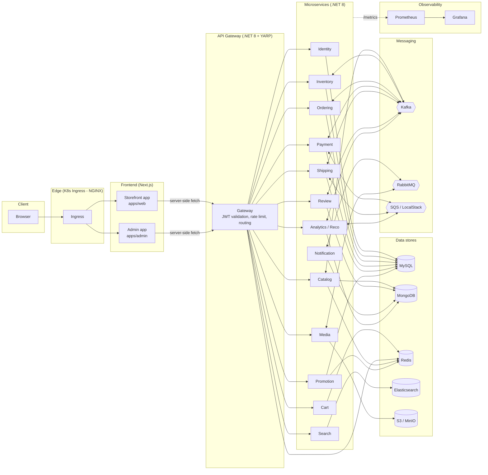
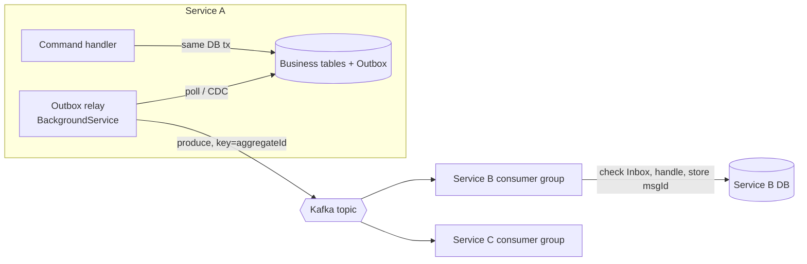
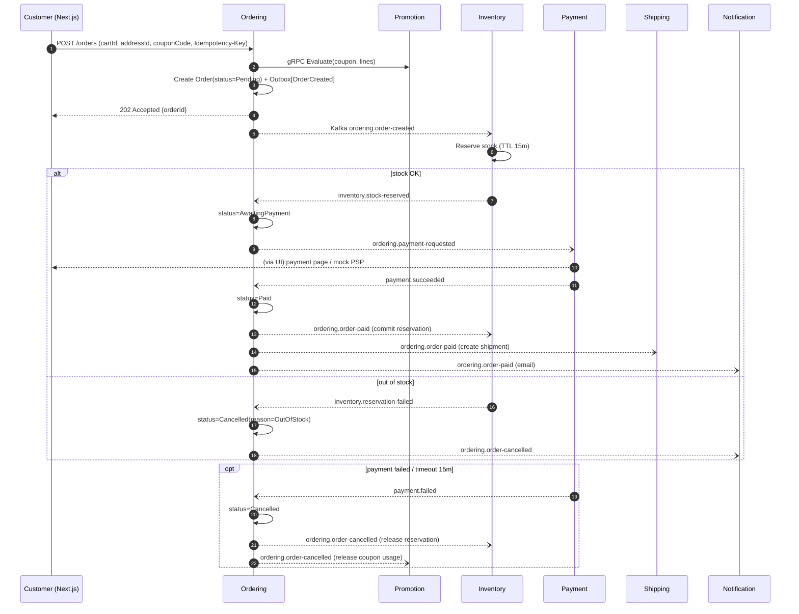
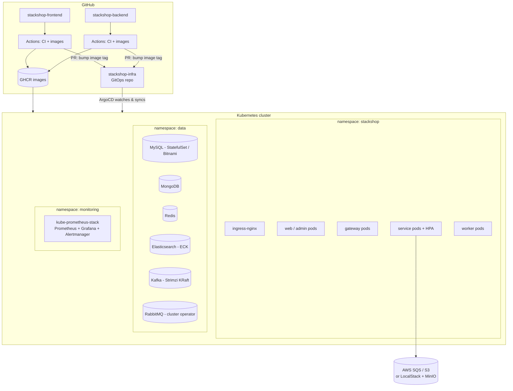
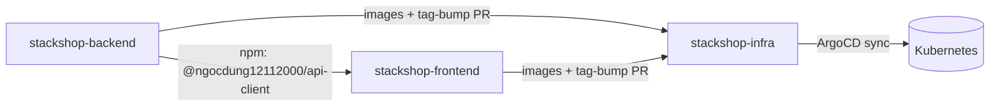

# 02 — System Architecture

## 1. Architectural style

**Event-driven microservices**. Each service uses **Clean Architecture** internally and is fronted by an **API Gateway**. The Next.js app acts as a **BFF**.

Key principles:

1. **Database per service.** No service reads another service's database. Data is shared only through APIs (sync) or events (async).
2. **Async by default between services.** Sync calls (HTTP/gRPC) are allowed only for queries where the user is waiting, and they must have timeouts, retries and circuit breakers.
3. **Reliable messaging.** Every state change that other services care about is published through a **Transactional Outbox**. Every consumer is **idempotent** (it uses an Inbox table or natural idempotency).
4. **Each broker has a clear job:**
   - **Kafka**: domain *events* (facts that happened), event streaming, replayable, many consumers.
   - **RabbitMQ**: *commands / work jobs* that one worker should process, with retry and DLQ (emails, image processing).
   - **SQS**: *cloud-edge integration*: buffering third-party webhooks and long-running export jobs. This mirrors how AWS-hosted systems decouple from the outside world.
5. **Stateless services.** All session/cart state lives in Redis, so any pod can serve any request. This allows horizontal scaling with HPA.
6. **Observability built in from day one.** Every service has metrics, structured logs, traces and health checks.

7. **Frontend and backend are fully separated.** They live in different repositories, are built and released independently, and talk only over HTTP through the API gateway (see §9).

> **Decision:** the backend is built as **microservices from day one**. There is no modular-monolith stage. To keep the early phases manageable, services are added phase by phase (Phase 1 starts with only `gateway`, `identity` and `catalog`). See [10-roadmap.md](./10-roadmap.md).

## 2. High-level diagram



## 3. Service catalogue

| Service | Responsibility | Store | Publishes (Kafka) | Consumes | Sync API |
|---------|----------------|-------|-------------------|----------|----------|
| **gateway** | Routing, JWT validation, rate limiting, CORS, request ID | Redis | – | – | REST (YARP) |
| **identity** | Register, login, JWT + refresh tokens, roles, profile, addresses | MySQL | `identity.user-registered` | – | REST |
| **catalog** | Categories, brands, products, variants (SKUs), prices | MongoDB, Redis | `catalog.product-*` | `review.rating-updated`, `media.image-processed` (RMQ) | REST + gRPC (`GetSkus`) |
| **search** | Full-text search, facets, autocomplete | Elasticsearch | – | `catalog.product-*`, `inventory.stock-changed`, `review.rating-updated` | REST |
| **inventory** | Stock per SKU/warehouse, reservations | MySQL, Redis (locks) | `inventory.stock-changed`, `inventory.reserved/failed/released` | `ordering.order-*` commands | REST + gRPC (`CheckStock`) |
| **cart** | Guest and user carts, merge on login | Redis | `cart.checked-out` (analytics) | `catalog.product-price-changed` | REST |
| **ordering** | Checkout, order lifecycle, **saga orchestrator** | MySQL | `ordering.order-*` | `inventory.*`, `payment.*`, `shipping.*` | REST |
| **payment** | Payment intents, mock PSP, refunds, webhooks | MySQL, SQS | `payment.*` | `ordering.payment-requested` | REST (+ webhook endpoint) |
| **shipping** | Shipments, mock carrier, tracking | MySQL, SQS | `shipping.*` | `ordering.order-paid` | REST (+ webhook endpoint) |
| **notification** | Email/in-app notifications, templates | MongoDB, RabbitMQ | – | Many Kafka events → RMQ jobs | REST + SignalR hub |
| **review** | Reviews, ratings, moderation | MongoDB | `review.*` | `ordering.order-delivered` (verified purchase) | REST |
| **promotion** | Coupons, discount rules, usage limits | MySQL, Redis | `promotion.coupon-redeemed` | `ordering.order-cancelled` (release usage) | REST + gRPC (`Evaluate`) |
| **media** | Upload (pre-signed URL), thumbnails | S3/MinIO, RabbitMQ | – (RMQ `media.image-processed`) | RMQ `media.process-image` | REST |
| **analytics** | Clickstream, recommendations, admin reports, exports | MongoDB, Redis, SQS | – | Almost all Kafka topics | REST |

## 4. Internal service structure (Clean Architecture)

```
services/ordering/
├── src/
│   ├── Ordering.Domain/          # Entities, value objects, domain events, no dependencies
│   ├── Ordering.Application/     # Use cases (MediatR commands/queries), validators, interfaces
│   ├── Ordering.Infrastructure/  # EF Core, repositories, Kafka producer, Outbox, external clients
│   └── Ordering.Api/             # Minimal API endpoints, DI wiring, auth, health, metrics
└── tests/
    ├── Ordering.UnitTests/
    ├── Ordering.IntegrationTests/ # Testcontainers (MySQL, Kafka)
    └── Ordering.ArchitectureTests/ # NetArchTest: layer rules
```

Shared building blocks live in `building-blocks/`. They are NuGet-style projects referenced by every service:

| Package | Contents |
|---------|----------|
| `BuildingBlocks.Common` | Result type, error model, pagination, clock abstraction |
| `BuildingBlocks.Messaging` | Integration event base, Kafka producer/consumer wrappers, Outbox/Inbox EF entities, relay `BackgroundService` |
| `BuildingBlocks.Observability` | OpenTelemetry setup, Serilog config, Prometheus exporter, standard metrics |
| `BuildingBlocks.Security` | JWT validation config, permission policies, current user accessor |
| `BuildingBlocks.Caching` | Redis cache-aside helpers, distributed lock |
| `BuildingBlocks.Testing` | Testcontainers fixtures, fake clock, test auth handler |

### Main .NET libraries

| Concern | Library |
|---------|---------|
| Web | ASP.NET Core 8 Minimal APIs, `Asp.Versioning` |
| CQRS / mediator | MediatR (or a hand-rolled mediator to avoid licence concerns) |
| Validation | FluentValidation |
| Mapping | Manual mapping or Mapster |
| MySQL | EF Core 8 + `Pomelo.EntityFrameworkCore.MySql` |
| MongoDB | `MongoDB.Driver` |
| Redis | `StackExchange.Redis` |
| Kafka | `Confluent.Kafka` (+ Schema Registry optional) |
| RabbitMQ / SQS | `MassTransit` **v8** (open source; v9+ is commercial) or raw `RabbitMQ.Client` / `AWSSDK.SQS` |
| Elasticsearch | `Elastic.Clients.Elasticsearch` 8.x |
| Gateway | YARP |
| Resilience | `Microsoft.Extensions.Http.Resilience` (Polly v8) |
| gRPC | `Grpc.AspNetCore` |
| Real-time | SignalR (Redis backplane) |
| Observability | OpenTelemetry .NET, `OpenTelemetry.Exporter.Prometheus.AspNetCore`, Serilog |
| Testing | xUnit, FluentAssertions, NSubstitute, Testcontainers, WireMock.Net, k6 (load) |

## 5. Communication patterns

### 5.1 Synchronous

```
Browser ──HTTPS──▶ Next.js (RSC / Route Handler / Server Action)
                     │  attaches access token from httpOnly cookie
                     ▼
                 API Gateway (YARP) ──HTTP/1.1──▶ service REST APIs
                                                   │
                         service ──gRPC (HTTP/2)──▶ service   (internal only, e.g. Ordering → Catalog.GetSkus)
```

- External traffic goes **only** through the gateway. gRPC is used only inside the cluster.
- Every outbound HTTP/gRPC call has a timeout (2s by default), a retry (3x with exponential backoff and jitter, idempotent calls only) and a circuit breaker.

### 5.2 Asynchronous



Delivery guarantee: **at-least-once** + **idempotent consumers** = effectively once.

## 6. Key flows

### 6.1 Checkout saga (orchestrated by Ordering)



### 6.2 Product change → search index

`catalog` writes the product → outbox → Kafka `catalog.product-updated` → `search` consumer builds the ES document (it calls `inventory` only if needed) → upserts into the index alias `products`.

### 6.3 Email notification

Kafka `ordering.order-paid` → `notification` consumer → it renders the template and publishes the RabbitMQ command `notification.send-email` → the email worker sends through SMTP (MailHog/Mailpit locally). On failure it retries with delays of 10s, 1m and 10m (delayed queues), then sends the message to the DLQ.

### 6.4 Payment webhook

Mock PSP → `POST /payments/webhooks/psp` (the gateway lets it through without JWT, and the HMAC signature is verified) → the API **only enqueues** the raw payload to SQS `payment-webhooks` and returns 200 quickly → a payment worker polls SQS, processes it idempotently (by `event_id`), updates the payment, and writes an outbox `payment.succeeded`.

## 7. Cross-cutting concerns

| Concern | Decision |
|---------|----------|
| **AuthN** | Identity service issues a JWT access token (RS256, 15 min) and a refresh token (7 days, rotating, stored hashed in MySQL). The JWKS endpoint is used by the gateway and services. |
| **AuthZ** | Role-based (`Customer`, `Admin`, `Support`) plus permission claims (`catalog:write`, `orders:refund`…). The gateway checks authentication, and the services enforce policies. |
| **Idempotency** | `Idempotency-Key` header on POST /orders and /payments. Stored in Redis for 24h along with the response. |
| **Correlation** | `X-Request-Id` is created at the gateway and propagated via W3C `traceparent` in HTTP and in message headers. |
| **Config** | `appsettings.json` + environment variables. In K8s: ConfigMap + Secret (Sealed Secrets / External Secrets for prod). |
| **Errors** | RFC 7807 `ProblemDetails` everywhere. |
| **Time** | All timestamps are UTC (`DATETIME(6)` / ISO-8601). The frontend formats them in the user's locale. |
| **Money** | `DECIMAL(18,2)` + ISO currency code. Never use float. A single currency (VND or USD) in phase 1. |
| **IDs** | `ULID`/`Guid v7` (sortable), generated by the application. |
| **API versioning** | URL segment `/api/v1/...` |
| **Health** | `/health/live` and `/health/ready` (checks DB/broker connectivity) |

## 8. Deployment view



Environments:

| Env | Where | Purpose |
|-----|-------|---------|
| `local` | Docker Compose | Day-to-day development, all infra in containers |
| `dev` | kind / k3d / minikube (local K8s) or a cheap cloud cluster | Learn K8s manifests, Helm, HPA |
| `staging` | Cloud K8s (optional) | Deployed automatically from `main` |
| `prod` | Cloud K8s (optional) | Deployed manually after approval, from a tag |

## 9. Repository layout (three repositories)

Frontend, backend and infrastructure are **three independent git repositories**. Each has its own CI pipeline, versioning and release cadence. None of them imports source code from another. They are connected only by **published artifacts**:

| Repository | Owns | Publishes | Consumes |
|------------|------|-----------|----------|
| `stackshop-frontend` | Next.js storefront + admin, shared UI, E2E tests | Container images `stackshop-web`, `stackshop-admin` (GHCR) | `@ngocdung12112000/api-client` npm package, the gateway URL |
| `stackshop-backend` | All .NET microservices, gateway, building blocks, event/proto contracts, seeder, load tests | One container image per service (GHCR), `@ngocdung12112000/api-client` npm package (GitHub Packages), OpenAPI documents | – |
| `stackshop-infra` | K8s manifests, Helm values for data stores, monitoring config, ArgoCD apps, local Compose for third-party infra | – (it *is* the desired state of every cluster) | Image tags from the other two repos (via automated PRs) |



Local workspace (this folder):

```
ALL STACKS APP/
├── docs/                      # ← you are here: shared design docs (not part of any repo)
├── CLAUDE.md
├── stackshop-frontend/        # git repo #1
├── stackshop-backend/         # git repo #2
└── stackshop-infra/           # git repo #3
```

### 9.1 `stackshop-frontend`

```
stackshop-frontend/
├── apps/
│   ├── web/                   # Next.js storefront
│   └── admin/                 # Next.js admin
├── packages/
│   ├── ui/                    # shared shadcn components + Tailwind preset
│   └── config/                # eslint, tsconfig, prettier
├── tests/e2e/                 # Playwright (runs against a deployed env or local gateway)
├── .github/workflows/         # ci.yml, build-images.yml, e2e.yml
├── .env.example               # API_BASE_URL=http://localhost:5000 ...
├── package.json, pnpm-workspace.yaml, turbo.json
└── CLAUDE.md
```

### 9.2 `stackshop-backend`

```
stackshop-backend/
├── services/
│   ├── gateway/
│   ├── identity/
│   ├── catalog/
│   ├── search/
│   ├── inventory/
│   ├── cart/
│   ├── ordering/
│   ├── payment/
│   ├── shipping/
│   ├── notification/
│   ├── review/
│   ├── promotion/
│   ├── media/
│   ├── analytics/
│   └── mock-psp/              # fake payment provider + fake carrier
│       (each: src/{X.Domain,X.Application,X.Infrastructure,X.Api}, tests/, Dockerfile, X.sln)
├── building-blocks/           # shared .NET libraries (see §4)
├── contracts/
│   ├── events/                # integration event JSON Schemas
│   ├── protos/                # gRPC .proto files
│   └── openapi/               # generated OpenAPI docs (CI artifact, committed snapshot)
├── clients/api-client/        # TS client generator project → published as @ngocdung12112000/api-client
├── tools/Seeder/
├── tests/load/                # k6
├── docker-compose.yml         # runs the .NET services; joins the infra network from stackshop-infra/local
├── .github/workflows/         # ci.yml, contracts.yml, build-images.yml, publish-client.yml, security.yml
├── StackShop.Backend.sln, Directory.Build.props, Directory.Packages.props
└── CLAUDE.md
```

Microservice independence rules inside the backend repo:

- Each service has **its own solution file, Dockerfile, image, version and deployment**. CI builds and deploys only the services that changed (path filters).
- Services may reference `building-blocks/*` and generated contract code only. A **service never references another service's projects.** An architecture test enforces this.
- Building blocks are versioned with the repo. A breaking change to a building block must build every service in CI.
- *Stretch goal:* publish building blocks as NuGet packages (GitHub Packages) so services can pin versions. This is the next step toward one repo per service.

### 9.3 `stackshop-infra`

```
stackshop-infra/
├── local/
│   ├── compose.yml            # MySQL, MongoDB, Redis, Kafka (+UI), RabbitMQ, Elasticsearch (+Kibana),
│   │                          # LocalStack/MinIO, Mailpit, Prometheus, Grafana  (network: stackshop)
│   └── init/                  # mysql schemas & users, mongo replica set, kafka topics, rabbitmq definitions, localstack queues/buckets
├── k8s/
│   ├── apps/<service>/base/   # Deployment, Service, HPA, PDB, NetworkPolicy, ServiceMonitor, migration Job
│   ├── apps/<service>/overlays/{dev,staging,prod}/   # image tag, replicas, resources
│   ├── platform/              # ingress-nginx, cert-manager, sealed-secrets, operators (Strimzi, RabbitMQ, ECK)
│   └── data/                  # data store CRs / Helm values per env
├── monitoring/
│   ├── dashboards/            # Grafana JSON (provisioned)
│   ├── rules/                 # PrometheusRule alerts
│   └── values-kube-prometheus-stack.yaml
├── argocd/                    # App-of-apps: one Application per service per env
├── terraform/                 # (stretch goal) cloud cluster, RDS, MSK, SQS…
├── .github/workflows/         # validate.yml (kustomize build, kubeconform, promtool, helm lint), e2e-trigger.yml
└── CLAUDE.md
```

### 9.4 Cross-repo contract flow

1. A backend change alters an API. CI regenerates the OpenAPI docs, and `publish-client.yml` publishes a new `@ngocdung12112000/api-client` version (semver: breaking API change → major).
2. Renovate/Dependabot opens a PR in `stackshop-frontend` to bump the client. Type errors show exactly what the frontend has to change.
3. Backend APIs stay **backward compatible for at least one frontend release**: add new fields/endpoints first, and remove old ones only after the frontend has moved (expand → migrate → contract).
4. For local development against an unreleased API, the frontend can generate the client straight from the running gateway (`pnpm gen:api --from http://localhost:5000/swagger/v1/swagger.json`).

## 10. Architecture Decision Records (summary)

| ADR | Decision | Reason |
|-----|----------|--------|
| 001 | Microservices with DB-per-service | The learning goal is distributed-systems patterns |
| 002 | Catalog in **MongoDB** | Products have different attributes per category (laptop vs shirt). Documents fit this naturally |
| 003 | Orders/Payments/Inventory in **MySQL** | They need ACID transactions, strong consistency and relational reporting |
| 004 | Cart in **Redis** only | It is high-churn and short-lived data. Hashes with a TTL fit well |
| 005 | **Kafka** for domain events | Ordered per key, replayable, many independent consumers (search, analytics) |
| 006 | **RabbitMQ** for jobs | Per-message ack, delayed retry, DLX, competing consumers, which suit emails and image jobs |
| 007 | **SQS** for webhooks and exports | Teaches the cloud-native queue model (visibility timeout, DLQ redrive), with LocalStack locally |
| 008 | Orchestrated saga in Ordering | The checkout flow is easier to reason about and observe than choreography |
| 009 | Transactional Outbox + Inbox | Avoids the dual-write problem without distributed transactions |
| 010 | YARP gateway in .NET | Same language as the services, so custom middleware is easy |
| 011 | Next.js BFF holds tokens in httpOnly cookies | Tokens are never exposed to JS, which reduces XSS impact |
| 012 | OpenTelemetry → Prometheus | Vendor-neutral, and the standard metric names make dashboards reusable |
| 013 | Three repositories: frontend, backend, infra (GitOps) | Independent release cycles for FE and BE. Infra changes are reviewed separately. Teaches cross-repo contracts and GitOps. See [adr/001-three-repositories.md](./adr/001-three-repositories.md) |
| 014 | Backend is microservices from the start (no modular monolith) | The learning goal is distributed-systems patterns. Services are introduced phase by phase to limit early complexity |

Full ADRs live in `docs/adr/` once implementation starts. Use the template in [adr/000-template.md](./adr/000-template.md).
