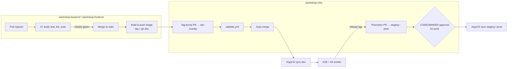

# 07 — DevOps: Docker, Kubernetes, CI/CD

## 1. Local development (Docker Compose, three repos)

There are three layers, one per repository. They are joined by a shared Docker network named `stackshop`:

| Repo | File | Contents |
|------|------|----------|
| `stackshop-infra` | `local/compose.yml` | MySQL, MongoDB (single-node replica set), Redis, Kafka (KRaft) + Kafka UI, RabbitMQ (management + delayed-message plugin), Elasticsearch + Kibana, LocalStack (SQS, S3) or MinIO, Mailpit (SMTP catcher), Prometheus, Grafana. It **creates** the `stackshop` network |
| `stackshop-infra` | `local/init/` | `mysql/01-create-schemas.sql` (schemas + users), `mongo/init-replica.js`, `localstack/init-aws.sh` (queues, buckets), `kafka/create-topics.sh`, `rabbitmq/definitions.json` |
| `stackshop-backend` | `docker-compose.yml` | All .NET services + gateway + mock-psp, built from their Dockerfiles. Joins the **external** `stackshop` network. Gateway on `localhost:5000` |
| `stackshop-frontend` | – (or `docker-compose.yml` for an image check) | `pnpm dev` runs web on :3000 and admin on :3001 with `API_BASE_URL=http://localhost:5000` |

Typical workflow:

```bash
# 1. third-party infrastructure (once per day)
cd stackshop-infra && docker compose -f local/compose.yml up -d
# 2a. backend: all services in containers
cd stackshop-backend && docker compose up -d --build
# 2b. …or only the services you are working on, from the IDE / `dotnet watch`
cd stackshop-backend/services/catalog && dotnet watch --project src/Catalog.Api
# 3. frontend
cd stackshop-frontend && pnpm install && pnpm dev
```

Frontend-only developers can skip building the backend. They set `BACKEND_IMAGE_TAG=latest` and run the backend compose with `pull_policy: always` to use the images from GHCR.

Local ports (suggested):

| Component | Port | UI |
|-----------|------|----|
| web / admin | 3000 / 3001 | – |
| gateway | 5000 | /swagger |
| MySQL | 3306 | (Adminer 8081 optional) |
| MongoDB | 27017 | (mongo-express 8082 optional) |
| Redis | 6379 | RedisInsight 5540 |
| Kafka | 9092 | Kafka UI 8085 |
| RabbitMQ | 5672 | 15672 |
| Elasticsearch | 9200 | Kibana 5601 |
| LocalStack | 4566 | – |
| MinIO | 9000 | 9001 |
| Mailpit | 1025 | 8025 |
| Prometheus | 9090 | ✓ |
| Grafana | 3002 | ✓ |

> **Resource note:** the full stack needs about 10–12 GB RAM. Set ES `-Xms1g -Xmx1g` and Kafka heap to 512m. Add Compose `profiles` (`search`, `messaging`, `monitoring`) so you can start only what you need.

## 2. Docker images

### .NET service (multi-stage, in `stackshop-backend/services/<svc>/Dockerfile`, build context = backend repo root)

```dockerfile
FROM mcr.microsoft.com/dotnet/sdk:8.0 AS build
WORKDIR /src
COPY Directory.Packages.props Directory.Build.props ./
COPY building-blocks/ building-blocks/
COPY contracts/ contracts/
COPY services/ordering/ services/ordering/
RUN dotnet restore services/ordering/src/Ordering.Api/Ordering.Api.csproj
RUN dotnet publish services/ordering/src/Ordering.Api/Ordering.Api.csproj -c Release -o /app --no-restore /p:UseAppHost=false

FROM mcr.microsoft.com/dotnet/aspnet:8.0-jammy-chiseled AS runtime
WORKDIR /app
COPY --from=build /app .
USER app
EXPOSE 8080
ENV ASPNETCORE_URLS=http://+:8080
ENTRYPOINT ["dotnet", "Ordering.Api.dll"]
```

### Next.js (in `stackshop-frontend/apps/<app>/Dockerfile`)

`output: 'standalone'`. Build stage on `node:22-alpine` (pnpm 11 requires Node ≥ 22.13) with pnpm + turbo prune. The runtime copies `.next/standalone`, `.next/static` and `public`, runs as a non-root user, and exposes 3000.

Image rules: non-root user, pinned base digests (Renovate/Dependabot updates them), `.dockerignore`, OCI labels (`org.opencontainers.image.revision`), Trivy scan in CI with failure on CRITICAL.

## 3. Kubernetes

### 3.1 Cluster for learning

- Local: **kind** or **k3d** (3 nodes) with ingress-nginx and metrics-server.
- Cloud (optional): AKS / EKS / GKE / DigitalOcean DOKS.

### 3.2 Namespaces

| Namespace | Contents |
|-----------|----------|
| `stackshop` | All app deployments |
| `data` | MySQL, MongoDB, Redis, Kafka (Strimzi), RabbitMQ (operator), Elasticsearch (ECK) |
| `monitoring` | kube-prometheus-stack |
| `argocd` | (optional) GitOps controller |

> In a real cloud deployment, prefer managed services (RDS, DocumentDB/Atlas, ElastiCache, MSK, Amazon MQ, OpenSearch, real SQS/S3). Running them in-cluster here is for learning.

### 3.3 Per-service manifests (Kustomize, in `stackshop-infra`)

All K8s manifests live in the **infra repo**. The app repos contain no manifests. ArgoCD (app-of-apps in `argocd/`) watches `stackshop-infra` and syncs each environment.

```
k8s/apps/ordering/base/
├── deployment.yaml      # 2 replicas, resources, probes, env from ConfigMap/Secret, securityContext
├── service.yaml         # ClusterIP 80 → 8080
├── hpa.yaml             # CPU 70% / custom metric (kafka lag via KEDA, stretch goal)
├── pdb.yaml             # minAvailable 1
├── configmap.yaml
├── servicemonitor.yaml  # Prometheus Operator scrape /metrics
├── networkpolicy.yaml   # allow from gateway + same namespace only
├── migration-job.yaml   # EF migrations bundle, run as a pre-deploy hook (ArgoCD sync wave -1)
└── kustomization.yaml
k8s/apps/ordering/overlays/{dev,staging,prod}/  # image tag, replica counts, resource sizes, ingress hosts
```

Deployment essentials:

```yaml
livenessProbe:  { httpGet: { path: /health/live,  port: 8080 }, periodSeconds: 10 }
readinessProbe: { httpGet: { path: /health/ready, port: 8080 }, periodSeconds: 5 }
startupProbe:   { httpGet: { path: /health/live,  port: 8080 }, failureThreshold: 30, periodSeconds: 2 }
resources: { requests: { cpu: 100m, memory: 192Mi }, limits: { memory: 384Mi } }
securityContext: { runAsNonRoot: true, readOnlyRootFilesystem: true, allowPrivilegeEscalation: false }
strategy: { type: RollingUpdate, rollingUpdate: { maxUnavailable: 0, maxSurge: 1 } }
```

Workers (consumers) are separate Deployments from the same image with `Mode=Worker`, so you can scale the API and consumers independently. Kafka consumers should not have more replicas than the topic has partitions.

Ingress hosts: `shop.stackshop.local` → web, `admin.stackshop.local` → admin, `api.stackshop.local` → gateway (WebSocket enabled for `/hubs`). TLS via cert-manager (self-signed locally, Let's Encrypt in the cloud).

Secrets: plain K8s Secrets in dev. **Sealed Secrets** or **External Secrets Operator** (with AWS Secrets Manager) in staging and prod.

## 4. CI/CD with GitHub Actions

### 4.1 Workflows

Each repository has its own workflows. **App repos never talk to the cluster.** They only build images and open PRs against `stackshop-infra`, and ArgoCD does the deploying.

**`stackshop-backend/.github/workflows/`**

| Workflow | Trigger | Jobs |
|----------|---------|------|
| `ci.yml` | PR + push | Detect changed services (`dorny/paths-filter`; a change in `building-blocks/**` or `contracts/**` marks **all** services as changed) → matrix per service: restore (NuGet cache) → build → unit tests → architecture tests (incl. "no cross-service references") → integration tests (Testcontainers) → coverage → `dotnet format --verify-no-changes` |
| `contracts.yml` | changes in `contracts/**` or any `*.Api` project | Validate event JSON Schemas, `buf breaking` on protos, regenerate OpenAPI and diff it against the committed snapshot with `oasdiff`. A breaking change needs the `breaking-api` PR label |
| `security.yml` | PR + nightly | CodeQL (C#), Gitleaks, dependency review, Trivy filesystem scan |
| `build-images.yml` | push to `main` | Matrix of changed services → Buildx (`type=gha` cache) → push `ghcr.io/<owner>/stackshop-<svc>:<sha>` → Trivy image scan → SBOM (Syft) → (stretch goal) cosign sign → **open a PR in `stackshop-infra`** updating `k8s/apps/<svc>/overlays/dev` to the new tag (auto-merge when infra CI passes) |
| `release.yml` | merge of a release PR | `release-please` in monorepo mode: **one version per service** (`ordering-v1.4.0`) → retag the image `:1.4.0` → open a staging promotion PR in infra |
| `publish-client.yml` | release of `gateway` or any API change on `main` | Generate the TS client from the aggregated OpenAPI → publish `@ngocdung12112000/api-client` to GitHub Packages |

**`stackshop-frontend/.github/workflows/`**

| Workflow | Trigger | Jobs |
|----------|---------|------|
| `ci.yml` | PR + push | pnpm install (cache) → lint → typecheck → vitest → `next build` (web, admin; Turborepo cache) → Playwright smoke against a mocked API (MSW) → Lighthouse CI on the storefront |
| `security.yml` | PR + nightly | CodeQL (TS), Gitleaks, `pnpm audit` |
| `build-images.yml` | push to `main` | Build `stackshop-web` / `stackshop-admin` images → push to GHCR → Trivy → open a tag-bump PR in `stackshop-infra` (dev overlay) |
| `release.yml` | release PR merge | `release-please` → version `web-v2.3.0`, `admin-v1.8.0` → staging promotion PR in infra |
| `e2e.yml` | `repository_dispatch: deployed` (sent by infra) + nightly | Full Playwright suite against the environment that was just deployed |

**`stackshop-infra/.github/workflows/`**

| Workflow | Trigger | Jobs |
|----------|---------|------|
| `validate.yml` | PR | `kustomize build` every overlay → `kubeconform` (schema validation) → `kube-linter` / Checkov → `promtool check rules` → Grafana dashboard JSON lint → diff preview comment (rendered manifest diff) |
| `post-sync.yml` | ArgoCD notification webhook → `repository_dispatch` | After a successful sync: send `repository_dispatch: deployed {env}` to the frontend repo (E2E) and run the k6 smoke test from the backend repo image. On failure: open an issue and ArgoCD rolls back to the previous revision |
| `promote.yml` | manual (`workflow_dispatch`: service, from-env, to-env) | Copy the image tag from one overlay to the next and open a PR. **Prod** PRs need CODEOWNERS approval (environment protection) |

Cross-repo auth: a **GitHub App** (preferred) or a fine-grained PAT with `contents:write` + `pull-requests:write` on `stackshop-infra` only, stored as `INFRA_REPO_TOKEN` in the app repos.

### 4.2 Pipeline diagram



### 4.3 Branch & quality rules

- Trunk-based: short-lived feature branches → PR → `main`.
- Branch protection: required checks (CI, CodeQL), 1 review (or self-review checklist when working solo), linear history.
- Conventional Commits (`feat(ordering): …`) enforced with commitlint. The scope is the service name in the backend repo, `web`/`admin`/`ui` in the frontend repo, and `<service>`/`monitoring`/`platform` in the infra repo.
- PR template: description, linked feature spec ID (e.g. `F07`), screenshots, test notes, checklist. A feature that spans repos has one PR per repo, all linking the same spec ID. Merge order is **backend → client publish → frontend → infra**.

## 5. Configuration matrix

| Setting | local | dev (kind) | staging/prod |
|---------|-------|------------|--------------|
| DB connection | compose hostnames | in-cluster services in `data` ns | managed DB endpoints from Secret |
| SQS/S3 | LocalStack / MinIO | LocalStack in cluster | real AWS (IRSA / workload identity) |
| Log level | Debug | Information | Information (Warning for EF) |
| Replicas | 1 | 1 | 2–3 + HPA |
| Seed data | yes (`--seed`) | yes | no |

## 6. Seed data

A `tools/Seeder` console app in `stackshop-backend` (also shipped as an image, so the infra repo can run it as a K8s Job in dev) that:

- Creates admin, support and 50 customer accounts.
- Imports about 500 products across 10 categories from a JSON fixture (with images uploaded to MinIO).
- Sets random stock levels and generates 2,000 historical orders and reviews so reports and charts have data.
- Triggers a search reindex.
