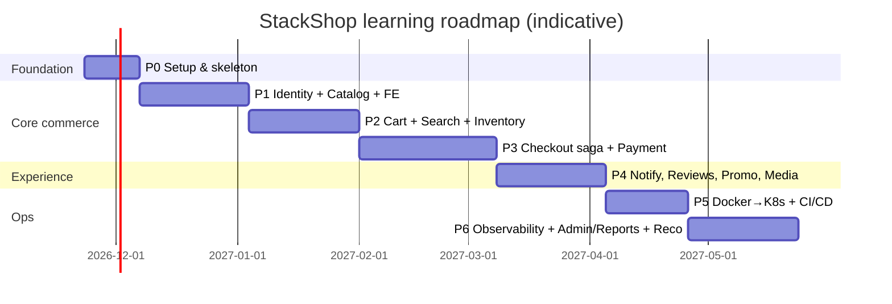

# 10 — Roadmap & Milestones

The plan has **7 phases**. Each phase ends with something working that you can demo, and introduces only a few new technologies, so learning stays manageable. Durations are rough estimates for one person learning part-time (~10–15 h/week).

> CI starts in P0 (one `ci.yml` per repo). P5 adds the image builds and GitOps deployment through `stackshop-infra`.
>
> **Microservices from day one:** new services are introduced only in the phase that needs them. P1 has `gateway`, `identity`, `catalog`. P2 adds `search`, `inventory`, `cart`. P3 adds `ordering`, `payment`, `shipping`, `mock-psp`. P4 adds `notification`, `review`, `promotion`, `media`. P6 adds `analytics`.

---

## Phase 0 — Foundation (≈2 weeks)

**Goal:** three repositories that each build on their own, with infra running locally.

**`stackshop-infra`**
- [x] `git init` + GitHub repo. `local/compose.yml` with MySQL, MongoDB, Redis, Mailpit, Prometheus and Grafana first, on the `stackshop` network. Kafka, RabbitMQ, ES and LocalStack are added in their own phase.
- [x] `local/init/mysql` schema + user scripts. `validate.yml` (empty k8s folder is fine for now).

**`stackshop-backend`**
- [x] `git init` + GitHub repo. Folder structure ([02-architecture.md §9.2](./02-architecture.md)), `Directory.Build.props`, `Directory.Packages.props` (central package management), `.editorconfig`.
- [x] `building-blocks`: Common (Result, errors), Observability (OTel + /metrics + Serilog), Security (JWT validation), Messaging (interfaces only).
- [x] Service template: a `catalog` skeleton with 4 layers, health checks, Swagger, a Dockerfile and test projects, saved as a `dotnet new` template (`dotnet new stackshop-service -n Ordering`) so every later service starts identical.
- [x] Architecture test: services must not reference each other.
- [x] `gateway` (YARP) routing to catalog. `docker-compose.yml` joining the infra network.
- [x] `ci.yml` (changed-service matrix, build + test).
- [x] OpenAPI generation + `publish-client.yml` → first `@ngocdung12112000/api-client@0.1.0` on GitHub Packages.

**`stackshop-frontend`**
- [x] `git init` + GitHub repo. pnpm + Turborepo workspace, `apps/web` with shadcn initialised (layout, header, footer, theme toggle), `packages/ui`, `packages/config`.
- [x] `.npmrc` for GitHub Packages, install `@ngocdung12112000/api-client`. MSW mocks.
- [x] `ci.yml` (lint, typecheck, test, build).

**Demo:** three repos with green CI. Infra compose up → backend compose up → `http://localhost:5000/api/v1/products` returns an empty list → `pnpm dev` shows the storefront calling the gateway through the published client. `/metrics` is visible in Prometheus.

**Status: done (2026-11-24).** Demo verified locally and CI is green in all three repos. Notes: the client is published as `@ngocdung12112000/api-client@0.1.1` (0.1.1 aligns it with the page-based catalog API); catalog uses an in-memory placeholder repository until its MongoDB store lands in Phase 1.

## Phase 1 — Identity, Catalog, Storefront basics (≈4 weeks)

**New tech:** EF Core + MySQL, MongoDB, Redis cache, JWT, Next.js RSC/Server Actions.

- [x] **F01** Identity & Auth (register, login, refresh, logout, confirm email *stubbed*, roles)
- [x] **F02** Profile & Address book
- [x] **F03** Catalog: categories, brands, products, variants. Admin CRUD API. Redis cache-aside
- [x] Storefront: home, category page (Mongo query for now), PDP, login/register, account pages
- [x] Admin app: login, product list/create/edit (no images yet)

**Demo:** an admin creates a product. A customer registers, logs in and browses it.

**Status: done (2026-11-28).** Demo verified locally: an admin created and published a product in `apps/admin`, and it showed on the storefront category page and PDP. Known gaps carried forward: no `/revalidate` webhook yet (storefront cache is 60 s, so AC-4 is open until Phase 2 events), no stock badge (F05), Support role has no read-only catalog access (`catalog:read` not seeded), category tree drag-reorder editor not built.

## Phase 2 — Cart, Search, Inventory (≈4 weeks)

**New tech:** Kafka, Outbox/Inbox, Elasticsearch, Redis data structures, gRPC.

- [ ] Kafka + Kafka UI in compose. `BuildingBlocks.Messaging` with Outbox relay and idempotent consumer
- [ ] Catalog publishes product events
- [ ] **F04** Search service: ES index, consumer, search API with facets, autocomplete. Category pages switch to ES
- [ ] **F05** Inventory: stock per SKU, admin adjust, `stock-changed` events, gRPC `CheckStock`
- [ ] **F06** Cart in Redis: guest + user, merge on login, price refresh from `price-changed` events
- [ ] Storefront: search page with facets, ⌘K search, cart drawer + cart page

**Demo:** edit a product's price → the search result and the cart show the new price within seconds (watch the messages in Kafka UI).

## Phase 3 — Checkout, Orders, Payment, Shipping (≈5 weeks)

**New tech:** Saga, SQS (LocalStack), idempotency keys, compensations.

- [ ] **F07** Ordering: place order, saga orchestrator, timeouts, order history
- [ ] Inventory reservations (reserve / commit / release / expire)
- [ ] **F08** Payment: mock PSP service, payment page, webhook → SQS FIFO → worker, refunds
- [ ] **F09** Shipping: shipment creation, mock carrier webhooks → SQS, tracking timeline
- [ ] Storefront: checkout flow, payment result page, order detail with timeline
- [ ] Admin: orders list/detail, cancel/refund

**Demo:** full purchase. Then kill the payment worker mid-flow, restart it, and watch the order complete. Also a forced payment failure → stock is released.

## Phase 4 — Notifications, Reviews, Promotions, Media, Wishlist (≈4 weeks)

**New tech:** RabbitMQ (retry/DLX), SignalR, MongoDB aggregation, Redis Lua, S3/MinIO pre-signed URLs.

- [ ] **F10** Notifications: Kafka → RabbitMQ email jobs, templates, Mailpit, in-app via SignalR, DLQ
- [ ] **F11** Reviews: verified purchase, moderation, rating aggregation → catalog + search
- [ ] **F12** Promotions & coupons: rules engine, Redis atomic usage, apply at checkout
- [ ] **F13** Wishlist
- [ ] **F14** Media: pre-signed upload, thumbnail worker via RabbitMQ, product images in admin

**Demo:** apply a coupon, receive an order email, get a real-time "Order shipped" toast, review the product, and see its rating update.

## Phase 5 — Containers, Kubernetes, CI/CD (≈3 weeks)

**New tech:** kind/k3d, Kustomize/Helm, operators, GHCR, **ArgoCD GitOps**, cross-repo automation (GitHub App).

- [ ] Production-grade Dockerfiles in the backend and frontend repos (image scan + SBOM)
- [ ] `stackshop-infra`: kind cluster + ingress-nginx + data operators (Strimzi, RabbitMQ, ECK) or Bitnami charts in `k8s/platform` and `k8s/data`
- [ ] `stackshop-infra`: Kustomize base/overlays for every service and both Next.js apps. Migration Jobs, HPA, PDB, NetworkPolicy. ArgoCD app-of-apps
- [ ] GitHub App with write access to the infra repo. `build-images.yml` in the backend and frontend repos opens tag-bump PRs
- [ ] `validate.yml`, `promote.yml`, `post-sync.yml` in infra. Prod environment protected by CODEOWNERS
- [ ] Frontend `e2e.yml` triggered by `repository_dispatch` after each deploy

**Demo:** merge a backend PR → its image is built → an infra PR is opened and auto-merged → ArgoCD updates the dev cluster → frontend E2E runs and passes. Then promote to staging with `promote.yml` and do a rollback with `git revert` in infra.

## Phase 6 — Observability, Admin & Reports, Recommendations, Hardening (≈4 weeks)

**New tech:** kube-prometheus-stack, PromQL, Grafana provisioning, alerting, k6, Kafka stream processing.

- [ ] **F17** Gateway hardening: rate limiting, request ID, WebSocket, aggregated Swagger
- [ ] ServiceMonitors for all services and exporters for every datastore and broker
- [ ] Dashboards + alert rules ([08-observability.md](./08-observability.md))
- [ ] **F15** Admin dashboard KPIs + reports + export via SQS
- [ ] **F16** Clickstream, trending, recently viewed, "frequently bought together"
- [ ] k6 load test → find and fix bottlenecks → document the results
- [ ] Ops page: DLQ viewer/replay, reindex trigger

**Demo:** run a k6 load test while watching Grafana. Trigger an alert by stopping a consumer and watching the lag climb.

---

## Stretch goals (after v1)

- Debezium CDC instead of polling the outbox.
- Avro + Schema Registry.
- KEDA autoscaling on Kafka lag and RabbitMQ queue depth.
- Loki + Tempo for logs and traces in Grafana (full LGTM stack).
- Linkerd/Istio mTLS + traffic splitting (canary releases with Argo Rollouts).
- Multi-vendor marketplace (seller onboarding, split payments).
- Real Stripe test mode integration.
- Terraform for cloud infrastructure (EKS + RDS + MSK + SQS).
- Feature flags (OpenFeature + flagd).

## Definition of Done (every feature)

- [ ] Spec acceptance criteria all pass
- [ ] Unit + integration tests written and green in CI
- [ ] OpenAPI annotations complete, new `@ngocdung12112000/api-client` version published, frontend bumped to it
- [ ] Public API changes are backward compatible (or versioned)
- [ ] Events documented in `stackshop-backend/contracts/` and [04-messaging-and-events.md](./04-messaging-and-events.md)
- [ ] Infra PR for any new service, env var, secret, alert or dashboard panel
- [ ] Metrics + logs added for the key operations
- [ ] Runs in Docker Compose (and in K8s after Phase 5)
- [ ] UI is responsive, accessible (keyboard + labels), and has loading/empty/error states
- [ ] Feature doc updated with anything that changed during implementation
