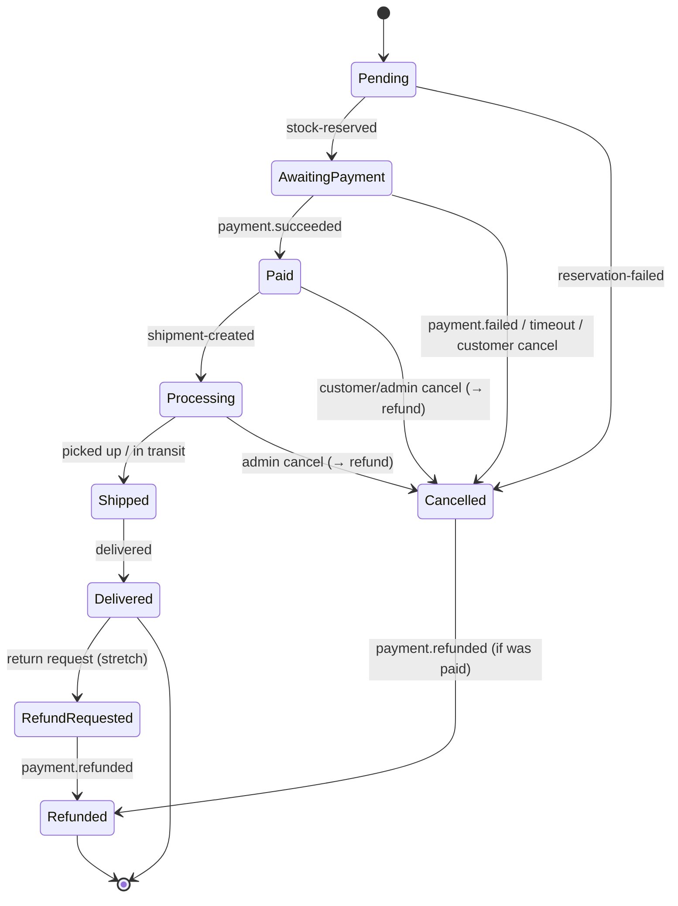

# F07 — Checkout & Order Management

| Field | Value |
|-------|-------|
| Phase | 3 |
| Service | `ordering` |
| Stack | EF Core + MySQL, saga orchestrator (state in MySQL), Outbox/Inbox, Kafka, gRPC clients, Redis idempotency, SignalR (via notification) |
| Frontend | `/checkout`, `/checkout/result/[orderId]`, `/account/orders`, admin orders |
| Depends on | F01, F02, F03, F05, F06, F08, F09, F12 |

## 1. User stories

| ID | Story |
|----|-------|
| US-07.1 | As a customer, I can check out my cart: choose an address, a shipping method, apply a coupon, review the totals and place the order |
| US-07.2 | As a customer, I'm told immediately if prices changed or items are out of stock before paying |
| US-07.3 | As a customer, I pay and see the order confirmation, with the status updating live |
| US-07.4 | As a customer, I can view my order history and the details/timeline of each order |
| US-07.5 | As a customer, I can cancel an order before it ships |
| US-07.6 | As support/admin, I can search orders, view details, cancel and trigger refunds |
| US-07.7 | Double-clicking "Place order" never creates two orders |

## 2. Checkout steps (UI)

1. **Address**: pick from the address book or add a new one (F02).
2. **Shipping**: Standard / Express. Fee from shipping rates (F09 `GET /shipping/quote`).
3. **Coupon**: apply/remove (F12).
4. **Review**: line items, subtotal, discount, shipping, tax, grand total. "Place order".
5. **Pay**: redirect to the mock PSP (F08) → return to the result page.

## 3. Place-order algorithm (`PlaceOrderCommand`)

```
1. Validate Idempotency-Key; if seen → return stored response (Redis idem:ordering:{key}, plus DB table as fallback).
2. Load cart (cart service HTTP).  Empty → 409 CART_EMPTY.
3. Re-price: catalog gRPC GetSkus(lines) → if any price differs from cart line → 409 PRICE_CHANGED (with new prices) – client refreshes & asks to confirm.
4. Pre-check stock: inventory gRPC CheckStock → insufficient → 409 INSUFFICIENT_STOCK (fast fail; real guarantee is reservation).
5. Shipping fee: shipping quote (by address zone & total weight).
6. Promotion: gRPC Evaluate(customerId, lines, subtotal, couponCode) → discount lines + reserve coupon usage (Reserved).
7. Tax: flat config rate (e.g., 10% VAT included/excluded – configurable) — simple TaxCalculator.
8. Create Order (Pending) + items (snapshots) + status history + saga_state + Outbox[order-created] in ONE transaction.
9. Store idempotency response; return 202 {orderId, orderNumber}.
```

## 4. Order state machine



Transitions are enforced in the `Order` aggregate (`order.MarkPaid(paymentId)` throws `InvalidOrderTransition` → 409). Every transition writes `order_status_history` and an outbox event.

## 5. Business rules

- BR-01: The order number format is `SS-{yyyyMMdd}-{6-digit daily sequence}` (MySQL sequence table, or Redis INCR with a daily key).
- BR-02: Item snapshots (name, variant label, image, unit price) are immutable after creation.
- BR-03: Payment deadline is 15 minutes after `stock-reserved`. Then the saga cancels the order (reason `PaymentTimeout`).
- BR-04: The customer can cancel in `Pending`, `AwaitingPayment` or `Paid` (before a shipment exists). Admin/support can cancel up to `Processing`. Cancelling a paid order triggers a full refund.
- BR-05: Money math uses `decimal` with banker's rounding at line level, and the totals are the sums of the rounded lines.
- BR-06: `grand_total = subtotal - discount_total + shipping_fee + tax_total` and must be ≥ 0.
- BR-07: A customer can only see their own orders (a 404 otherwise).
- BR-08: All event handlers are idempotent (Inbox) and tolerate out-of-order arrival (e.g. `payment.succeeded` arriving after cancellation → trigger a refund and log it).

## 6. API

| Method | Path | Auth | Description |
|--------|------|------|-------------|
| POST | `/api/v1/orders/preview` | Customer | Same as place but no side effects → returns full totals (used on the review step) |
| POST | `/api/v1/orders` | Customer + `Idempotency-Key` | Place order → 202 |
| GET | `/api/v1/orders?status=&page=` | Customer | My orders |
| GET | `/api/v1/orders/{id}` | Customer (own) / Support | Detail + timeline + payment & shipment summary |
| POST | `/api/v1/orders/{id}/cancel` | Customer (own) / Support | `{reason}` |
| GET | `/api/v1/admin/orders?status=&q=&from=&to=&page=` | `orders:read` | Search by order number / email |
| POST | `/api/v1/admin/orders/{id}/cancel` | `orders:cancel` | |
| POST | `/api/v1/admin/orders/{id}/refund` | `orders:refund` | `{amount?, reason}`. Full by default; partial is a stretch goal |
| GET | `/api/v1/admin/orders/{id}/saga` | Admin | Saga state for debugging (learning aid) |

Errors: `CART_EMPTY`, `PRICE_CHANGED`, `ORDER_INSUFFICIENT_STOCK`, `COUPON_INVALID`, `ORDER_INVALID_TRANSITION`, `IDEMPOTENCY_KEY_REUSED_WITH_DIFFERENT_PAYLOAD` (422).

## 7. Events

See the saga table in [04-messaging-and-events.md §7](../04-messaging-and-events.md).
Publishes: `order-created`, `payment-requested`, `order-paid`, `order-cancelled`, `order-shipped`, `order-delivered`, `order-refunded`.
Consumes: `inventory.stock-reserved/reservation-failed`, `payment.succeeded/failed/refunded`, `shipping.shipment-created/status-changed`.

## 8. Frontend

- `/checkout`: a multi-step page (shadcn `Tabs` or a custom stepper). The right column has a sticky `OrderSummary`. Step state lives in the URL (`?step=shipping`). The Idempotency-Key is generated once per checkout session (`crypto.randomUUID()` kept in sessionStorage) and reused across retries.
- A `PRICE_CHANGED` response shows a dialog listing the old and new prices, with a "Confirm & continue" button.
- `/checkout/result/[orderId]`: a status card that subscribes to SignalR `order:{id}` (or polls every 3s) and moves from "Reserving stock…" to "Waiting for payment" to "Paid 🎉" or "Cancelled (reason)".
- `/account/orders`: a list with status badges and filters. Detail page: items, totals, address, timeline (vertical stepper from status history + shipment events), cancel button when allowed.
- Admin: an orders DataTable (filters: status, date range, search), a detail page with timeline, saga state panel, and cancel/refund actions with confirm dialogs.

## 9. Non-functional

- Place-order p95 < 500ms (excluding async steps).
- Order created → AwaitingPayment p95 < 2s.
- Metrics: `orders_created_total`, `orders_status_total{status}`, `checkout_saga_duration_seconds{outcome}`, `order_value` histogram.

## 10. Acceptance criteria

- AC-1: The happy path results in `Paid` and then `Delivered` via the mock carrier. The timeline shows every step.
- AC-2: Sending the same `POST /orders` twice with the same Idempotency-Key returns the same orderId, and only one order exists.
- AC-3: A price changed after adding to the cart → 409 `PRICE_CHANGED`. After confirming, the order uses the new price.
- AC-4: Insufficient stock at reservation → the order is `Cancelled(OutOfStock)` and the customer is notified.
- AC-5: No payment within 15 minutes (use a fake clock / short config in tests) → `Cancelled(PaymentTimeout)`, the reservation is released and the coupon usage is released.
- AC-6: The customer cancels a paid order before it ships → `Cancelled` → refund event → `Refunded`.
- AC-7: Killing the ordering pod mid-saga and restarting it → the saga continues from the persisted state.
- AC-8: Customer A cannot view customer B's order (404).

## 11. Tasks

1. Domain: `Order` aggregate + state machine + money value object + unit tests for every transition.
2. Persistence + migrations, order-number generator.
3. Clients: cart (HTTP), catalog/inventory/promotion (gRPC), shipping quote (HTTP), all with resilience.
4. `PlaceOrder` / `PreviewOrder` handlers. Idempotency middleware/filter.
5. Saga orchestrator: event handlers that update `saga_state`. `SagaTimeoutWorker`.
6. Customer and admin query endpoints (with Dapper for list queries, as an EF vs Dapper exercise).
7. Frontend checkout, result page, account orders, admin orders.
8. Integration tests: a full saga with Testcontainers (MySQL + Kafka) and fake downstream consumers.
9. Playwright: checkout happy path + payment failure.

## 12. Learning focus

Saga orchestration and compensation, state machines, idempotency, outbox/inbox in practice, consistency trade-offs, money handling, resilient sync calls, real-time UX.
