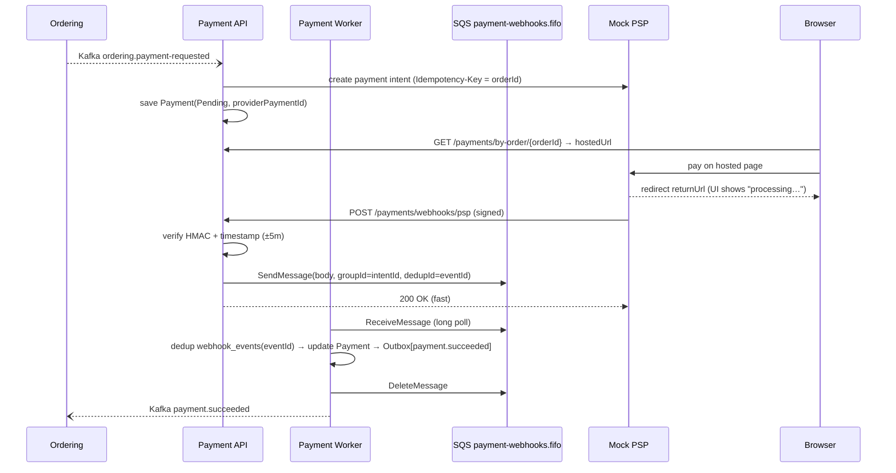

# F08 — Payments

| Field | Value |
|-------|-------|
| Phase | 3 |
| Services | `payment`, `mock-psp` (fake provider) |
| Stack | EF Core + MySQL, **SQS FIFO** (LocalStack) for webhook ingestion, Kafka, HMAC, idempotency |
| Frontend | `/checkout/pay/[orderId]`, mock PSP hosted page |
| Depends on | F07 |

## 1. Why a mock PSP?

Real providers (Stripe, VNPay, PayPal) all follow the same pattern: **create a payment intent → redirect / client confirm → asynchronous webhook with the final result**. `mock-psp` is a tiny .NET service + Razor page that copies this pattern, so you can learn the hard parts (webhooks, retries, idempotency, signature verification) offline.

Mock PSP behaviour:

- `POST /v1/payment_intents {amount, currency, metadata{orderId}, returnUrl, webhookUrl}` → `{id, clientSecret, hostedUrl}`
- Hosted page `/pay/{id}` shows test cards:
  - `4242…` → succeeds
  - `4000…0002` → declined
  - `4000…9995` → insufficient funds
  - `4000…3220` → "requires action" (extra confirm screen)
  - `4000…0077` → succeeds, but the webhook is delivered **twice** and **late** (30s) to test idempotency
- After the outcome: redirect to `returnUrl?payment_intent={id}` and send a webhook `POST webhookUrl` with header `X-PSP-Signature: t={ts},v1={HMAC_SHA256(secret, ts + "." + body)}`. Retries with backoff until it gets a 2xx (max 5).
- `POST /v1/refunds {paymentIntentId, amount}` → async `refund.succeeded` webhook.

## 2. User stories

| ID | Story |
|----|-------|
| US-08.1 | As a customer, I'm redirected to a payment page showing the amount, and I can pay with a test card |
| US-08.2 | As a customer, if payment fails I can retry with another card until the order deadline |
| US-08.3 | As a customer, I'm refunded automatically when a paid order is cancelled |
| US-08.4 | As an admin, I can see payment attempts, statuses and refunds per order |

## 3. Flow

## 4. Business rules

- BR-01: One `Payment` per order. A retry after a failed card creates a new **attempt** on the same intent (the mock PSP allows reusing the intent until it succeeds or is cancelled).
- BR-02: The webhook endpoint never trusts the redirect. **Only the webhook decides the outcome.** The return page just polls the order status.
- BR-03: Signature check: HMAC-SHA256 with a shared secret, constant-time compare, timestamp tolerance 5 minutes. Otherwise 400 (and the PSP won't retry).
- BR-04: Webhook processing is idempotent by `provider_event_id` (PK in `webhook_events`).
- BR-05: State transitions: Pending → (RequiresAction) → Succeeded | Failed. Succeeded → Refunded / PartiallyRefunded. A webhook that implies an invalid transition is logged and acked.
- BR-06: Amount check: the webhook amount must equal the payment amount. A mismatch puts the payment in a `Flagged` state and raises an alert (fraud scenario).
- BR-07: A refund is triggered by `ordering.order-cancelled{wasPaid:true}` or by an admin refund (through ordering). Payment calls the PSP refund API, then the webhook `refund.succeeded` → `payment.refunded` event.
- BR-08: If `payment.succeeded` arrives for an order that is already cancelled (timeout race), ordering asks for an automatic refund.

## 5. API

| Method | Path | Auth | Description |
|--------|------|------|-------------|
| GET | `/api/v1/payments/by-order/{orderId}` | Customer (own) | `{status, amount, hostedUrl?, attempts[]}` |
| POST | `/api/v1/payments/{id}/retry` | Customer (own) | Returns a fresh hostedUrl if the order is still AwaitingPayment |
| POST | `/api/v1/payments/webhooks/psp` | HMAC | Enqueue to SQS only → 200 |
| GET | `/api/v1/admin/payments?status=&from=&to=` | `orders:read` | |
| GET | `/api/v1/admin/payments/{id}` | | Attempts, webhook log, refunds |

## 6. SQS details

- Queue `payment-webhooks.fifo`: `ContentBasedDeduplication=false`, explicit `MessageDeduplicationId = eventId` (5-minute dedup window), `MessageGroupId = paymentIntentId` (ordered per payment).
- Worker: `ReceiveMessage(MaxNumberOfMessages=10, WaitTimeSeconds=20, VisibilityTimeout=30)` → process → `DeleteMessage`. On exception, do not delete (it becomes visible again). After 5 receives it goes to `payment-webhooks-dlq.fifo` and the alert `DLQNotEmpty` fires.
- Worker hosting: `BackgroundService` in the `payment` image with `Mode=Worker`.

## 7. Frontend

- `/checkout/pay/[orderId]`: fetch the payment → redirect to `hostedUrl` (or embed it in an iframe). A countdown shows the remaining payment time.
- Return URL `/checkout/result/[orderId]` (from F07) shows the live status. On failure it shows a "Try another card" button → retry endpoint.
- Admin order detail: a payment panel with attempts and webhook events (JSON viewer) and the refund status.

## 8. Acceptance criteria

- AC-1: Paying with 4242 → order `Paid` within 3s of the webhook.
- AC-2: Card 0002 → payment `Failed`. The customer retries with 4242 → `Paid`.
- AC-3: Card 0077 (duplicate, late webhooks) → only one `payment.succeeded` event is emitted.
- AC-4: A webhook with a bad signature → 400, nothing is enqueued.
- AC-5: Stopping the worker, paying, then starting the worker → the message is processed from SQS and the order is paid (durability).
- AC-6: A poison message (malformed JSON) ends up in the DLQ after 5 attempts. The alert fires.
- AC-7: Cancelling a paid order → refund → `payment.refunded` → order `Refunded`.

## 9. Tasks

1. `mock-psp` service: intents, hosted Razor page, webhook sender with retries, refunds.
2. Payment domain + persistence.
3. Kafka consumer `payment-requested` → create intent (HTTP client with idempotency).
4. Webhook endpoint (HMAC verify) → SQS producer (`AWSSDK.SQS`, LocalStack endpoint config).
5. SQS worker + dedup + outbox.
6. Refund flow.
7. LocalStack init script for queues + DLQ redrive policy.
8. Frontend pay/result pages + admin payment panel.
9. Tests: HMAC unit tests, integration with Testcontainers LocalStack, Playwright payment success/failure.

## 10. Learning focus

The webhook pattern, signatures, SQS FIFO semantics (group ID, dedup ID, visibility timeout, DLQ), "accept fast, process async", idempotency end to end, race conditions between timeouts and late events.
