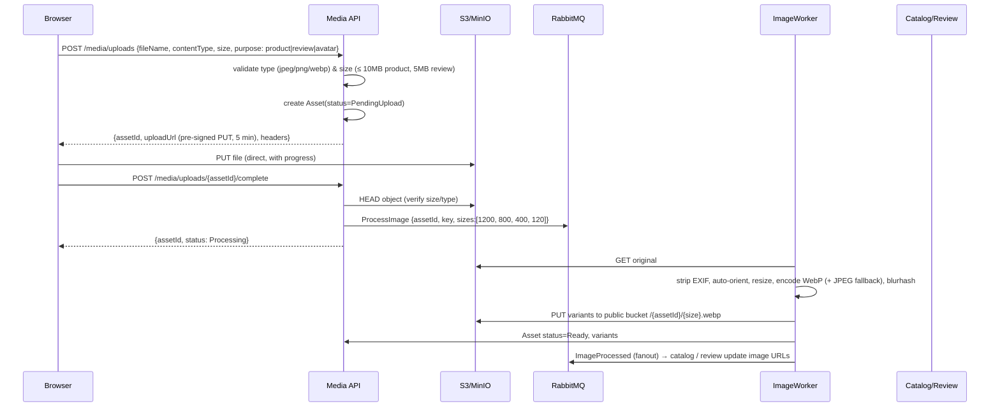

# F14 — Media / Image Upload

| Field | Value |
|-------|-------|
| Phase | 4 |
| Service | `media` (API + ImageWorker) |
| Stack | S3 (MinIO or LocalStack locally), pre-signed URLs, **RabbitMQ** work queue, ImageSharp, MongoDB (asset metadata) or MySQL |
| Frontend | Admin product image manager, review photo uploader, avatar |
| Depends on | F01 |

## 1. User stories

| ID | Story |
|----|-------|
| US-14.1 | As an admin, I can drag and drop multiple product images, see upload progress, reorder them and set alt text |
| US-14.2 | As a customer, I can attach up to 5 photos to a review |
| US-14.3 | As a shopper, I get fast, correctly sized images (thumbnails, WebP) |

## 2. Upload flow

## 3. Rules

- BR-01: Allowed types are checked by the declared content type **and** by magic bytes in the worker (reject a disguised file → status `Rejected`).
- BR-02: Max dimensions are 8000×8000 (decompression-bomb guard). ImageSharp `Configuration` memory limits apply.
- BR-03: Originals go to a private bucket. Variants go to a public-read bucket (or are served via a CDN/Next image loader).
- BR-04: Orphan cleanup: assets still `PendingUpload` after 1h, or `Ready` but never attached after 24h, are deleted by a daily job. Attach is signalled by catalog/review calling `POST /media/assets/{id}/attach {ownerType, ownerId}`.
- BR-05: Worker retries: 3 attempts with delays (5s, 30s, 2m) → DLQ.

## 4. API

| Method | Path | Description |
|--------|------|-------------|
| POST | `/api/v1/media/uploads` | Start upload → pre-signed URL |
| POST | `/api/v1/media/uploads/{assetId}/complete` | Verify + enqueue |
| GET | `/api/v1/media/assets/{assetId}` | Status + variant URLs |
| POST | `/api/v1/media/assets/{id}/attach` | Internal |
| DELETE | `/api/v1/media/assets/{id}` | Owner/admin |

## 5. Frontend

- A reusable `ImageUploader` (in `packages/ui`) with a drop zone, per-file progress (XHR `upload.onprogress` to the pre-signed URL), a preview, a processing spinner (polls the asset status), drag-sort (`@dnd-kit`) and an alt-text input.
- `next.config` `images.remotePatterns` for the public bucket host. A custom loader picks the closest pre-generated size.

## 6. Acceptance criteria

- AC-1: Uploading 5 images in admin → all become `Ready` with 4 WebP sizes each, and they appear on the PDP after publishing.
- AC-2: Renaming a `.exe` to `.jpg` → status `Rejected`. The product is unaffected.
- AC-3: An expired pre-signed URL (> 5 minutes) → S3 returns 403. The UI asks to retry.
- AC-4: Killing the worker mid-processing → the message is redelivered and processed exactly once (idempotent by assetId + status check).

## 7. Learning focus

Pre-signed URLs (no file bytes through your API), S3 APIs, RabbitMQ competing consumers with low prefetch for CPU-heavy jobs, image pipelines, orphan cleanup jobs.
