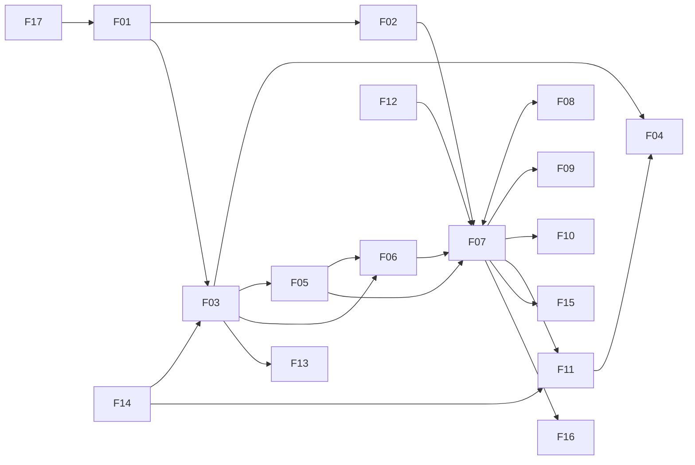

# Feature Specs

Each spec follows the same structure: **summary table → user stories → business rules → data/API → events → frontend → non-functional → acceptance criteria → implementation tasks → learning focus**.

| ID | Feature | Service(s) | Phase | Key stack |
|----|---------|-----------|-------|-----------|
| [F01](./F01-identity-auth.md) | Identity & Authentication | identity | 1 | MySQL, JWT, Redis |
| [F02](./F02-profile-addresses.md) | Profile & Address Book | identity | 1 | MySQL |
| [F03](./F03-product-catalog.md) | Product Catalog | catalog | 1–2 | MongoDB, Redis, Kafka, gRPC |
| [F04](./F04-product-search.md) | Product Search | search | 2 | Elasticsearch, Kafka |
| [F05](./F05-inventory.md) | Inventory | inventory | 2–3 | MySQL locking, Kafka, gRPC |
| [F06](./F06-shopping-cart.md) | Shopping Cart | cart | 2 | Redis (primary), Lua |
| [F07](./F07-checkout-orders.md) | Checkout & Orders | ordering | 3 | MySQL, Saga, Outbox, Kafka |
| [F08](./F08-payments.md) | Payments | payment, mock-psp | 3 | SQS FIFO, webhooks, HMAC |
| [F09](./F09-shipping-fulfillment.md) | Shipping & Fulfillment | shipping | 3 | SQS standard, Kafka |
| [F10](./F10-notifications.md) | Notifications | notification | 4 | RabbitMQ, SignalR, MongoDB |
| [F11](./F11-reviews-ratings.md) | Reviews & Ratings | review | 4 | MongoDB aggregation |
| [F12](./F12-promotions-coupons.md) | Promotions & Coupons | promotion | 4 | Rule engine, Redis Lua |
| [F13](./F13-wishlist.md) | Wishlist | catalog | 4 | MongoDB |
| [F14](./F14-media-upload.md) | Media Upload | media | 4 | S3/MinIO, RabbitMQ |
| [F15](./F15-admin-reports.md) | Admin, Dashboard & Reports | analytics + all | 1→6 | Read models, SQS exports |
| [F16](./F16-activity-recommendations.md) | Activity & Recommendations | analytics | 6 | Kafka streaming, Redis ZSET/HLL |
| [F17](./F17-api-gateway-platform.md) | API Gateway & Platform | gateway | 0→6 | YARP, rate limiting |

## Dependency graph

## Spec ID conventions

- `US-xx.n`: user story. `BR-n`: business rule. `AC-n`: acceptance criterion. Reference them in PR titles and test names, e.g. `F07_AC2_SameIdempotencyKey_ReturnsSameOrder`.
